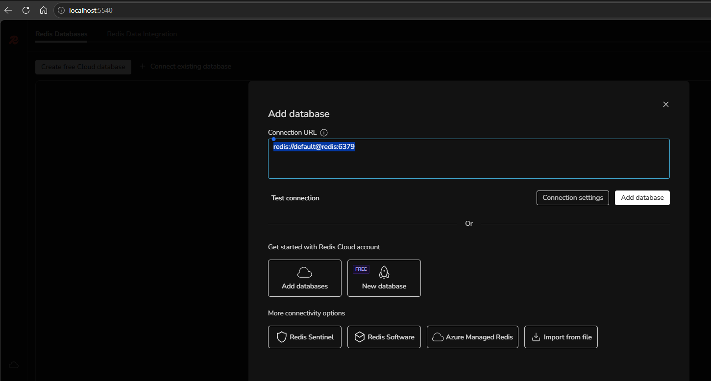
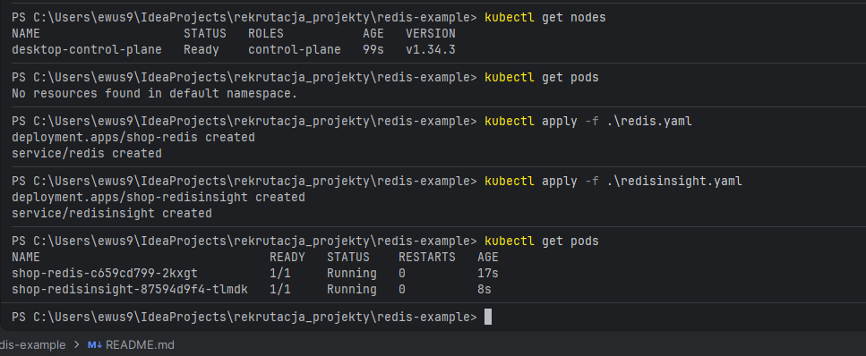
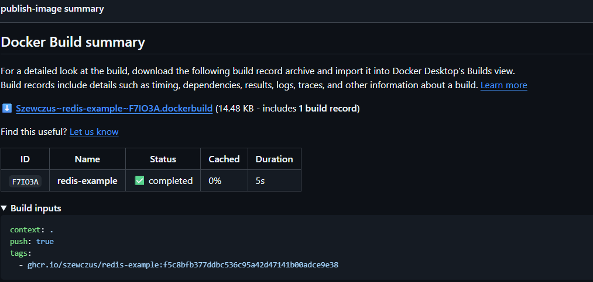
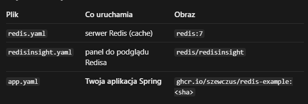

kubectl get nodes
kubectl apply -f redis.yaml
kubectl apply -f redisinsight.yaml
kubectl get pods

kind create cluster --name dev --config kind-config.yaml
kubectl port-forward service/redis 6379:6379

Baza w RedisInsight	Adres
główna (dev)	redis://default@redis:6379
testowa	redis://default@redis-test:6379

obraz został zbudowany i wysłany do rejestru.

$env:GITHUB_PAT | docker login ghcr.io -u Szewczus --password-stdin
docker pull ghcr.io/szewczus/redis-example:f5c8bfb377ddbc536c95a42d47141b00adce9e38
docker run --rm -p 8080:8080 -e SPRING_DATA_REDIS_HOST=host.docker.internal   ghcr.io/szewczus/redis-example:f5c8bfb377ddbc536c95a42d47141b00adce9e38

Krok 1: klaster (minikube)
minikube start --driver=docker
kubectl config use-context minikube
kubectl get nodes

Krok 2: Redis w klastrze
docker compose down
kubectl apply -f redis.yaml
kubectl get pods

Krok 3: sekret do prywatnego obrazu
$env:GITHUB_PAT = Read-Host "Token"
$env:GITHUB_PAT.Length
kubectl create secret docker-registry ghcr-secret  --docker-server=ghcr.io --docker-username=Szewczus --docker-password=$env:GITHUB_PAT

DO MONITOROWANIA:
PS C:\Users\ewus9\IdeaProjects\rekrutacja_projekty\redis-example> kubectl apply -f redisinsight.yaml
PS C:\Users\ewus9\IdeaProjects\rekrutacja_projekty\redis-example> kubectl port-forward service/redisinsight 5540:5540

APLIKACJA
PS C:\Users\ewus9\IdeaProjects\rekrutacja_projekty\redis-example> kubectl port-forward service/redis-example 8080:8080
PS C:\Users\ewus9\IdeaProjects\rekrutacja_projekty\redis-example> kubectl apply -f app.yaml

redis://default@redis:6379